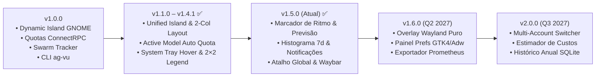

# Roadmap — Antigravity View Usage

Este documento traça o planejamento estratégico e a evolução do projeto **Antigravity View Usage** ao longo das próximas versões.

---

## 🗺️ Visão Geral dos Marcos

---

## 📌 Versões Planejadas

### [v1.0.0] — Lançamento Inicial ✅
- [x] Extensão GNOME Shell 45-50+ com arquitetura ESM pura.
- [x] Integração na Top Bar ao lado do `DateMenu` nativo sem alterar relógio ou calendário.
- [x] 3 estágios da Dynamic Island: pílula compacta (28px), expansão em hover e dashboard Glassmorphism.
- [x] Coletor de telemetria autônomo em Python 3 (`ag-vu`) com zero dependências externas.
- [x] Descoberta automática de instâncias do Antigravity Language Server via ConnectRPC.
- [x] Monitor de cotas em tempo real: Gemini 4 Argon, Gemini Models e Claude/GPT 3P.
- [x] Leitura de sessões e árvores de agentes do Swarm (`conversation_summaries.db`).
- [x] Indexador incremental de transcripts com cache baseado em `mtime_ns`.
- [x] CLI com modos `--pretty`, `--json`, `--watch` e `--pin-group`.
- [x] Scripts de instalação (`install.sh`) e desinstalação (`uninstall.sh`).

---

### [v1.1.0 – v1.3.1] — Unified Island, Tema Adaptativo & Refinamento de UX ✅
- [x] **Unified Dynamic Island (Date/Time + Antigravity)**: cápsula única sobre `_centerBox`, calendário nativo preservado, 100% reversível no `disable()`.
- [x] **Tema Adaptativo do Ubuntu (Light/Dark)**: compatibilidade com `org.gnome.desktop.interface` e cores Yaru/Adwaita.
- [x] **Hot-Reload Dinâmico no Wayland**: carregamento modular `island.js` com cache-busting sem deslogar da sessão.
- [x] **Detecção de Modelo Ativo Real**: vínculo dinâmico da cota primária na barra ao modelo em execução na IDE via `gen_metadata`.
- [x] **Estilo Nativo Ubuntu System Tray**: cápsula 100% transparente em repouso e hover em retângulo suavemente arredondado (8px).
- [x] **Simplificação para 2 Estágios**: remoção do hover expansivo na barra, garantindo estabilidade e foco.

---

### [v1.4.0 – v1.4.1] — Dashboard em 2 Colunas & Grade de Legenda ✅ (2026-11-13)
- [x] **Dashboard em 2 Colunas (720px)**: layout equilibrado estilo Ubuntu Calendar Popover.
- [x] **Coluna Esquerda (345px)**: Cotas de modelos (barras de 310px), Legenda 2×2 e Sessão Ativa com badge do modelo ativo.
- [x] **Coluna Direita (335px)**: Agentes do Swarm completos sem corte vertical e Consumo Mensal com ranking de Top Projetos.
- [x] **Legenda da Pílula em Grade 2×2 Alinhada**: colunas verticais estritas (`colA` e `colB`) com pontos circulares travados em 8×8px.
- [x] **Remoção de Scroll nos Agentes**: visualização direta de todos os membros do Swarm sem barras de rolagem cinzentas.

---

### [v1.5.0] — Inteligência de Ritmo, Notificações Nativas & Integração (Atual) ✅ (2026-11-13)
- [x] **Indicador de Ritmo (*Pace Marker*) & Previsão de Esgotamento**:
  - Marcador vertical fino nas barras de progresso indicando a cota esperada para o tempo decorrido da janela (semanal / 5h).
  - Cálculo de burn rate acelerado (`pace_status: fast`) com estimativa amigável de esgotamento (`~Xh`) antes do reset.
- [x] **Mini Histograma de Atividade 7 Dias**:
  - Gráfico compacto de barras diárias (`daily_history`) na coluna direita com hover interativo revelando o total de tokens do dia.
- [x] **Notificações Nativas do Sistema (`Main.notify`)**:
  - Alertas automáticos do GNOME Shell para transições críticas de cota (< 20% aviso, < 10% crítico) e renovação de cota (reset).
  - Persistência com anti-spam inteligente em `~/.cache/antigravity-vu/notify_state.json`.
- [x] **Compatibilidade com Blur My Shell**:
  - Detecção em runtime de `blur-my-shell@aunetx` aplicando translucidez e cantos arredondados contínuos.
- [x] **Atalho de Teclado Global Configurável**:
  - Abertura imediata do Dashboard via atalho padrão `<Super><Alt>a` gerenciado por schema GSettings (`org.gnome.shell.extensions.antigravity-vu`).
- [x] **Suporte a Waybar (`--waybar`)**:
  - Modo CLI para saída JSON em linha única voltado para status bars leves e compositores Wayland.

---

### [v1.6.0] — Ecossistema Wayland & Extensibilidade 🌐 (Q2 2027)
- [ ] **Modo Floating Overlay (Wayland Layer Shell)**:
  - Aplicação independente em Python/GTK4 ou Rust para ambientes que não utilizam GNOME Shell (Hyprland, Sway, KDE Plasma 6).
- [ ] **Interface Gráfica de Configuração (`prefs.js`)**:
  - Diálogo nativo em GTK4 / Libadwaita integrado ao aplicativo *Extensões* do GNOME.
- [ ] **Exportador de Métricas para Prometheus / Grafana**:
  - Flag CLI `ag-vu --serve-metrics :9100` expondo métricas de cota e tokens no formato padrão do Prometheus.
- [ ] **Suporte a Plugins e Custom Hooks**:
  - Acionamento de scripts personalizados ao ocorrer eventos (ex: avisos em Discord/Slack).

---

### [v2.0.0] — Inteligência Financeira & Gestão Avançada 🚀 (Q3 2027)
- [ ] **Multi-Conta & Troca Rápida de Perfil**:
  - Suporte a múltiplos perfis de login do Google Cloud / Antigravity com comutação via menu.
- [ ] **Estimativa Financeira e Economia de Prompt Cache**:
  - Cálculo estimativo de economia financeira obtida através dos tokens lidos de prompt cache vs chamadas diretas.
- [ ] **Histórico Temporal em Banco Dedicado**:
  - Armazenamento de telemetria histórica em SQLite local para geração de relatórios de consumo mensal, semanal e diário.

---

*Sugestões e pedidos de novas funcionalidades podem ser abertos na seção de Issues do repositório!*
