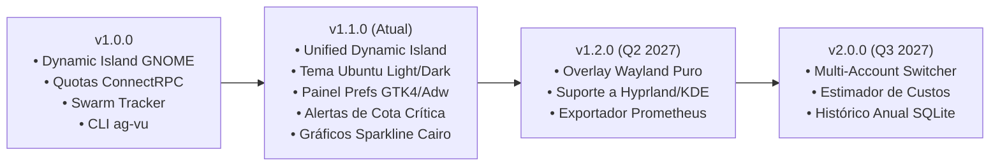

# Roadmap — Antigravity View Usage

Este documento traça o planejamento estratégico e a evolução do projeto **Antigravity View Usage** ao longo das próximas versões.

---

## 🗺️ Visão Geral dos Marcos

---

## 📌 Versões Planejadas

### [v1.0.0] — Lançamento Inicial (Atual) ✅
- [x] Extensão GNOME Shell 45-50+ com arquitetura ESM pura.
- [x] Integração na Top Bar ao lado do `DateMenu` nativo sem alterar relógio ou calendário.
- [x] 3 estágios da Dynamic Island: pílula compacta (28px), expansão em hover e dashboard Glassmorphism.
- [x] Coletor de telemetria autônomo em Python 3 (`ag-vu`) com zero dependências externas.
- [x] Descoberta automática de instâncias do Antigravity Language Server via ConnectRPC.
- [x] Monitor de cotas em tempo real: Gemini 4 Argon, Gemini Models e Claude/GPT 3P.
- [x] Leitura de sessões e árvores de agentes do Swarm (`conversation_summaries.db`).
- [x] Indexador incremental de transcripts com cache baseado em `mtime_ns`.
- [x] CLI com modos `--pretty`, `--json`, `--watch` e `--pin-group`.
- [x] Scripts de instalação (`install.sh`) e desinstalação (`uninstall.sh`).

---

### [v1.1.0] — Unified Island & Tema Adaptativo ✅ (2026-11-12)
- [x] **Unified Dynamic Island (Date/Time + Antigravity)**: cápsula única sobre `_centerBox`, calendário nativo preservado, reversível no `disable()`.
- [x] **Adaptive Ubuntu System Theme (Light/Dark)** com cores de acento Yaru/Adwaita.
- [x] Fix do `PopupMenu` (colapso de altura no GNOME 50).

### [v1.2.0-pre] — Experiência do Usuário & Alertas Nativos 🎯 (adiado da 1.1)
- [ ] **Interface Gráfica de Configuração (`prefs.js`)**:
  - Diálogo nativo em GTK4 / Libadwaita integrado ao aplicativo *Extensões* do GNOME.
  - Seleção visual do grupo de cota fixado na pílula.
  - Ajuste deslizante do intervalo de atualização (2s a 30s).
- [ ] **Notificações de Cota Crítica**:
  - Alerta nativo do sistema quando qualquer cota cair abaixo de 10% ou 5%.
  - Notificação de aviso 30 minutos antes do reset semanal.
- [ ] **Mini-Gráficos Sparkline em Cairo**:
  - Renderização vetorial leve de sparkline da velocidade de tokens nos últimos 30 minutos.
- [ ] **Atalhos de Teclado Globais**:
  - Atalho configurável (ex: `Super + Shift + A`) para alternar a exibição da Dynamic Island ou abrir o dashboard.

---

### [v1.3.0] — Ecossistema Wayland & Extensibilidade 🌐
- [ ] **Modo Floating Overlay (Wayland Layer Shell)**:
  - Aplicação independente em Python/GTK4 ou Rust para ambientes que não utilizam GNOME Shell (Hyprland, Sway, KDE Plasma 6).
- [ ] **Exportador de Métricas para Prometheus / Grafana**:
  - Flag CLI `ag-vu --serve-metrics :9100` expondo métricas de cota e tokens no formato padrão do Prometheus.
- [ ] **Suporte a Plugins e Custom Hooks**:
  - Capacidade de acionar scripts personalizados ao ocorrer eventos (ex: alertar canal do Discord/Slack quando o swarm finalizar uma tarefa).

---

### [v2.0.0] — Inteligência Financeira & Gestão Avançada 🚀
- [ ] **Multi-Conta & Troca Rápida de Perfil**:
  - Suporte a múltiplos perfis de login do Google Cloud / Antigravity com comutação via menu.
- [ ] **Estimativa Financeira e Economia de Prompt Cache**:
  - Cálculo estimativo de economia financeira obtida através dos tokens lidos de prompt cache vs chamadas diretas.
- [ ] **Histórico Temporal em Banco Dedicado**:
  - Armazenamento de telemetria histórica em SQLite local para geração de relatórios de consumo mensal, semanal e diário.

---

*Sugestões e pedidos de novas funcionalidades podem ser abertos na seção de Issues do repositório!*
