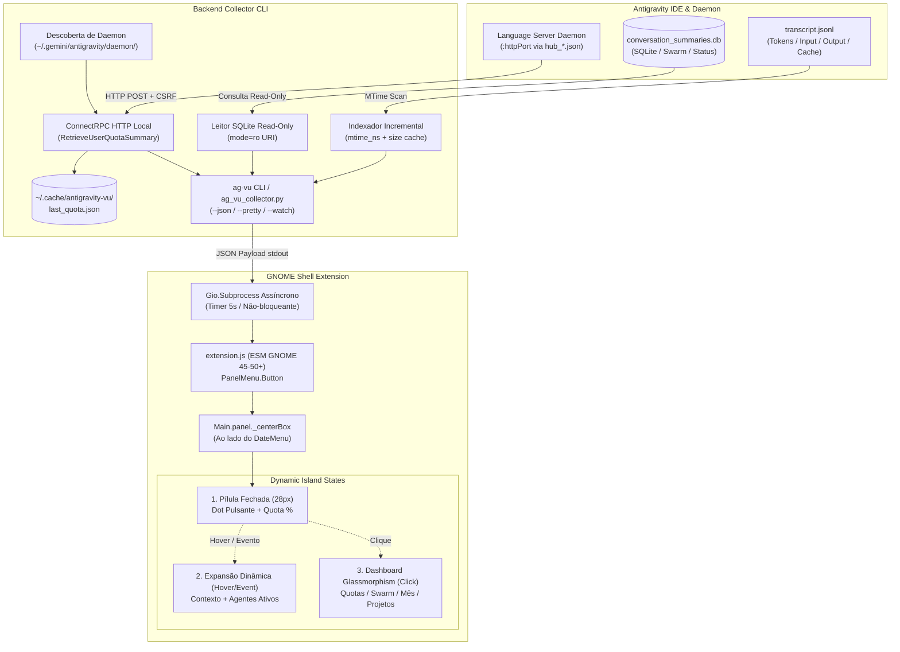

# Arquitetura Técnica — Antigravity View Usage (Dynamic Island GNOME)

Este documento descreve detalhadamente a arquitetura de software, fluxo de dados, integração com o GNOME Shell e diretrizes de performance do **Antigravity View Usage** (`antigravity-vu`).

---

## 1. Visão Geral e Filosofia de Design

O **Antigravity View Usage** foi projetado para fornecer aos desenvolvedores uma visão em tempo real de suas cotas de inteligência artificial (Gemini 4 Argon, Gemini Pro/Flash, modelos Claude e GPT), uso de tokens de contexto, consumo mensal consolidado e status de agentes paralelos (*swarm*).

### Princípios Norteadores
1. **Zero Overhead de CPU e RAM**: Nenhum loop contínuo de renderização no compositor do desktop. Animações aceleradas por hardware via Clutter/Mutter e execução assíncrona desacoplada do processo do GNOME Shell.
2. **Unified Dynamic Island**: o contêiner central (`_centerBox`) é estilizado como uma única cápsula (`.ag-unified-island-capsule`) que engloba o `dateMenu` nativo e o indicador Antigravity, preservando o calendário do GNOME e restaurando tudo no `disable()`.
2b. **Adaptive Ubuntu System Theme**: tema Light/Dark e cor de acento seguem o sistema.
3. **Resiliência e Funcionamento Offline**: Mecanismo de cache persistente inteligente (`last_quota.json` e `transcript_index.json`) que garante visualização das últimas métricas mesmo quando o Language Server ou a IDE estão fechados.
4. **Arquitetura Desacoplada**: Um coletor/CLI Python 3 puro sem bibliotecas externas atua como motor analítico, enquanto a extensão GNOME Shell atua como interface visual reativa.

---

## 2. Diagrama de Fluxo e Topologia



---

## 3. Coletor de Telemetria (`backend/ag_vu_collector.py`)

O coletor opera como um binário CLI autônomo e biblioteca de extração. Ele é responsável por consultar três fontes locais distintas:

### 3.1. Descoberta Dinâmica do Language Server (ConnectRPC)
O Antigravity executa em segundo plano o daemon `language_server`. As informações de conexão são descobertas dinamicamente:
- **Localização dos metadados**: `~/.gemini/antigravity/daemon/hub_<port>.json`.
- **Conteúdo**: `{ "httpPort": <port>, "csrfToken": "<token>", "lsVersion": "..." }`.
- **Fallback de Ambiente**: Caso as variáveis `ANTIGRAVITY_LS_ADDRESS` e `ANTIGRAVITY_CSRF_TOKEN` estejam presentes, elas são utilizadas diretamente.
- **Chamada HTTP**:
  - `POST http://127.0.0.1:<port>/exa.language_server_pb.LanguageServerService/RetrieveUserQuotaSummary`
  - Headers: `x-codeium-csrf-token: <token>`, `Content-Type: application/json`.
  - Timeout estrito de 1.5s para evitar congelamento em caso de shutdown do processo.
- **Cache de Quotas**: Se a chamada for bem-sucedida, os dados são salvos em `~/.cache/antigravity-vu/last_quota.json`. Se o servidor estiver temporariamente fechado, o coletor retorna os dados em cache com `ls_online: false`.

### 3.2. Extração de Swarm e Sessões (`conversation_summaries.db`)
O status dos agentes e do projeto atual é lido diretamente do banco SQLite central do Antigravity:
- **Caminho**: `~/.gemini/antigravity/conversation_summaries.db`.
- **Abertura Segura**: Aberto estritamente em modo leitura com URI `file:<path>?mode=ro` e timeout reduzido, garantindo que locks da IDE nunca causem contenção.
- **Campos Extraídos**:
  - `status`: `CASCADE_RUN_STATUS_RUNNING` (ativo/working) ou `CASCADE_RUN_STATUS_IDLE` (ocioso/waiting).
  - `agent_name`: Nome da persona do agente (ex: `coordinator`, `explorer`, `researcher`, `gnome-dev`, `verifier`, `monitor`).
  - `parent_conversation_id`: Identificador da sessão coordenadora para reconstrução da árvore hierárquica do swarm.
  - `workspace_uris`: Identificação do projeto ativo (ex: `file:///home/.../antigravity-vU-linux`).

### 3.3. Indexador Incremental de Tokens (`transcript.jsonl`)
O Antigravity registra os turnos de conversa em arquivos JSON Lines por sessão (`~/.gemini/antigravity/brain/<conversation_id>/.system_generated/logs/transcript.jsonl`):
- **Otimização de Performance**: Em projetos com histórico extenso, reprocessar megabytes de JSON a cada 5 segundos seria ineficiente.
- **Algoritmo de Cache Incremental**:
  1. O arquivo `~/.cache/antigravity-vu/transcript_index.json` armazena o mapa `{ <path>: { "mtime_ns": ..., "size": ..., "tokens": { "in": ..., "cache": ..., "out": ... } } }`.
  2. Ao executar, o coletor faz apenas um `os.stat` rápido em cada transcript.
  3. Se `mtime_ns` e `size` não mudaram, reutiliza os totais calculados instantaneamente.
  4. Se mudou, lê apenas as linhas do arquivo e recalcula a soma de `input_tokens`, `cache_read_tokens` e `output_tokens`.
- **Agregações Geradas**:
  - **Mês Corrente (`monthly_tokens`)**: Total acumulado no mês atual, permitindo avaliar a taxa de acerto do Prompt Cache (`cache_read_tokens` vs `input_tokens`).
  - **Top Projetos (`projects`)**: Ranking dos projetos com maior tráfego de contexto.

---

## 4. Arquitetura da Extensão GNOME Shell (`extension/`)

A extensão foi desenvolvida para os padrões modernos do GNOME 45 até GNOME 50+:

### 4.1. Módulos ECMAScript (ESM)
Elimina o sistema legado `imports.ui` em favor dos imports nativos do GJS:
```javascript
import Clutter from 'gi://Clutter';
import Gio from 'gi://Gio';
import GLib from 'gi://GLib';
import GObject from 'gi://GObject';
import St from 'gi://St';
import { Extension } from 'resource:///org/gnome/shell/extensions/extension.js';
import * as Main from 'resource:///org/gnome/shell/ui/main.js';
import * as PanelMenu from 'resource:///org/gnome/shell/ui/panelMenu.js';
import * as PopupMenu from 'resource:///org/gnome/shell/ui/popupMenu.js';
```

### 4.2. Integração com a Barra Superior e DateMenu
No GNOME Shell, o painel central (`Main.panel._centerBox`) acomoda por padrão o `dateMenu` (relógio/calendário).
O **Antigravity View Usage** se registra no painel através de:
```javascript
Main.panel.addToStatusArea(this.uuid, this._indicator, 1, 'center');
```
**Vantagens dessa abordagem**:
1. **Intocabilidade do DateMenu**: O relógio nativo do sistema, notificações de calendário e tempo permanecem 100% inalterados e protegidos contra quebras em atualizações do sistema operacional.
2. **Auto-Centralização Fluida**: O layout manager do Mutter recalcula o posicionamento de `_centerBox` dinamicamente conforme sua largura total varia, mantendo o conjunto Relógio + Dynamic Island perfeitamente centralizado na tela.

### 4.2.1. Unified Dynamic Island (v1.1.0)
- `Main.panel._centerBox` recebe `.ag-unified-island-capsule`; lado esquerdo (`.ag-unified-island-date`) = `dateMenu` nativo (calendário/notificações); lado direito (`.ag-unified-island-indicator`) = Dashboard Antigravity.
- Hover em qualquer parte da ilha expande com `actor.ease()`.
- `_removeUnifiedIsland()` desconecta listeners e restaura classes originais no `disable()`.
- O dropdown usa `PopupMenu.PopupMenuSection` (sem `St.ScrollView`) e helpers `createVBox`/`createHBox` com `orientation`, evitando colapso de altura no GNOME 50.

### 4.2.2. Adaptive Ubuntu System Theme (v1.1.0)
- `Gio.Settings('org.gnome.desktop.interface')` monitora `color-scheme`, `gtk-theme` e `accent-color`.
- Classes `.ag-theme-dark` / `.ag-theme-light` na ilha e no menu; 9 cores de acento (blue, orange, purple, green, red, yellow, teal, pink, slate).

### 4.3. Os Três Estágios da Dynamic Island

```
+-------------------------------------------------------------+
| ESTÁGIO 1: Pílula Fechada (28px de altura)                  |
|   [ (●) Argon 31.4% ]                                       |
+-------------------------------------------------------------+
                                │
                  Hover / Evento de Atividade
                                ▼
+-------------------------------------------------------------+
| ESTÁGIO 2: Expansão Dinâmica (Morphing 200ms)               |
|   [ (●) Argon 31.4%  │  Ctx: 48.2k  •  ⚡ 3 ag ]            |
+-------------------------------------------------------------+
                                │
                          Clique do Usuário
                                ▼
+-------------------------------------------------------------+
| ESTÁGIO 3: Dashboard Glassmorphism (PopupMenu)              |
|                                                             |
|   ANTIGRAVITY VIEW USAGE                Pro [ONLINE] [ ↻ ]  |
|   ───────────────────────────────────────────────────────   |
|   QUOTA TRACKER (VIEW USAGE)                                |
|     Gemini 4 Argon     [████░░░░░░]  31.4%   Reset: 3d 5h   |
|     Gemini Models      [███████░░░]  64.3%   Reset: 3d 5h   |
|     Claude & GPT (3P)  [██████████] 100.0%   Reset: 6d 23h  |
|                                                             |
|   CONTEXTO & SWARM ATIVO                                    |
|     Projeto: antigravity-vU-linux     Ctx Total: 48.2k      |
|     In: 12.4k  │  Prompt Cache: 35.8k  │  Out: 4.1k         |
|     ● coordinator [WORKING] (14 steps)                      |
|     ● explorer    [WORKING] (8 steps)                       |
|     ● gnome-dev   [WORKING] (4 steps)                       |
|                                                             |
|   TOKENS DO MÊS (2026-11) & PROJETOS                        |
|     [ IN: 1.25M ]      [ CACHE: 8.42M ]    [ OUT: 185k ]    |
|     1. antigravity-vU-linux (3.61M)                         |
+-------------------------------------------------------------+
```

### 4.4. Ciclo Assíncrono e Consumo de Recursos
- **Sem bloqueio da UI**: Toda a leitura de dados ocorre fora da thread principal do GNOME Shell através de `Gio.Subprocess.new(['ag-vu', '--json'], ...)` com leitura assíncrona do `stdout` via `communicate_utf8_async`.
- **Limpeza Rigorosa no `disable()`**: Ao desativar a extensão ou bloquear a tela, todos os timers (`GLib.source_remove`), conexões de sinais e subprocessos ativos são cancelados e liberados da memória.

---

## 5. Especificação do Contrato JSON

O coletor emite na saída padrão um JSON estruturado de acordo com o esquema:

```json
{
  "timestamp": "ISO-8601 String",
  "user": {
    "name": "Nome do Desenvolvedor",
    "tier": "Pro | Free | Enterprise",
    "ls_online": true
  },
  "primary_quota": {
    "group": "Gemini 4 Argon",
    "window": "weekly",
    "remaining_pct": 31.4,
    "reset_in": "3d 5h",
    "status_level": "healthy | warning | critical"
  },
  "quota_groups": [
    {
      "name": "Nome Amigável",
      "id": "argon | gemini | 3p",
      "buckets": [
        {
          "id": "bucket-id",
          "label": "Weekly | 5-Hour",
          "window": "weekly | 5h",
          "remaining_pct": 31.4,
          "reset_time": "ISO-8601",
          "reset_in": "3d 5h"
        }
      ]
    }
  ],
  "active_context": {
    "conversation_id": "UUID",
    "title": "Título da Sessão Ativa",
    "project_name": "Nome da Pasta do Projeto",
    "context_tokens": 48200,
    "context_formatted": "48.2k",
    "input_tokens": 12400,
    "cache_read_tokens": 35800,
    "output_tokens": 4100
  },
  "swarm": {
    "active_count": 3,
    "total_alive": 4,
    "is_working": true,
    "agents": [
      {
        "name": "explorer",
        "role": "worker",
        "status": "WORKING",
        "is_working": true,
        "steps": 8
      }
    ]
  },
  "monthly_tokens": {
    "month": "2026-11",
    "input_tokens": 1250000,
    "cache_read_tokens": 8420000,
    "output_tokens": 185000,
    "total_tokens": 9855000,
    "input_formatted": "1.25M",
    "cache_formatted": "8.42M",
    "output_formatted": "185.0k",
    "total_formatted": "9.86M"
  },
  "projects": [
    {
      "name": "nome-do-projeto",
      "path": "/caminho/absoluto",
      "total_tokens": 3612000,
      "total_formatted": "3.61M",
      "conversations_count": 4
    }
  ]
}
```

---

## 6. Configurações do Usuário (`prefs.json`)

As preferências do usuário são persistidas em `~/.config/antigravity-vu/prefs.json`:
- `pinned_group`: Define qual grupo de quotas deve ter destaque na pílula fechada (`"auto"`, `"argon"`, `"gemini"`, `"3p"`). No modo `"auto"`, o sistema seleciona automaticamente o grupo com menor percentual restante entre os ativos.
- `refresh_interval`: Intervalo de atualização em segundos (padrão: `5`).
- `expand_on_activity`: Booleano para expandir a pílula dinamicamente por alguns segundos quando um agente entra em estado `WORKING`.
